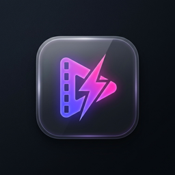

# LightAF Editor

<p align="center">
  
</p>

A lightweight, portable Windows video & meme editor with a **persistent Meme & Sound Library**, multi-track timeline, real-time canvas preview, and FFmpeg-powered MP4 export up to **4K (3840×2160)**—no bloated suites or cloud accounts required.

## Features

- **Portable & Zero-Bloat**: Runs directly from a single folder on Windows via `LightAFEditor.exe` (opens in a standalone Microsoft Edge app window). All media, thumbnails, projects, and exports stay inside the folder.
- **Persistent Meme & Sound Library**:
  - Drag and drop or select videos, meme clips, sound effects, and images.
  - Files are copied into `data/library/` with auto-generated thumbnails (`data/thumbs/`) and metadata (`data/library.json`), so they stay available across sessions and new projects.
  - Filter by **All**, **★ Fav**, **Memes**, **SFX**, **Footage**, **Images**, search by name, quick-preview in place, multi-select to bulk delete, and drag-and-drop onto the timeline.
- **Multi-Track Timeline & Custom Layers**:
  - Starts with `V2` (Overlay / Meme), `V1` (Main Video), `A1` (SFX / Sound), `A2` (Music / Audio), plus **`+ Video Layer`** and **`+ Audio Layer`** to add unlimited custom layers with custom names, colors, and mute/hide toggles.
  - Drag to move, drag edges to trim, **Multi-Track & Multi-Clip Selection** (`Ctrl+Click`, `Shift+Click`, marquee box), **Undo (`Ctrl+Z`)**, **Redo (`Ctrl+Y` / `Ctrl+Shift+Z`)**, **Split (`S`)**, **Duplicate (`Ctrl+D`)**, **Delete (`Del`)**, edge snapping, `Ctrl + Scroll` timeline zoom, and automatic playhead scrolling.
- **Text Overlays & Clip Inspector**:
  - Add **`+ Text`** overlays with multi-line text, font family, size (`16px–220px`), bold/italic, text color, outline, background box, and **direct drag-to-position** on the preview canvas (exported via FFmpeg `drawtext`).
  - Adjust **Speed (`0.1x–100x`)** with `1x` reset, **Fade In / Fade Out** durations (visual alpha & audio gain), **Volume (`0%–200%`)**, **Mute**, **Opacity (`0%–100%`)**, and overlay **Scale (`10%–500%`) / Position X / Position Y** for memes and images.
  - Inspect media properties (format, resolution, duration, file size, and audio/video streams), or bulk-edit volume/mute/opacity when multiple clips are selected.
- **High-Resolution Export**:
  - Export MP4 (H.264 + AAC) in **720p**, **1080p**, **2K (1440p)**, **4K (2160p)**, **9:16 Vertical (1080p/2K/4K)**, and **1:1 Square**.
- **Dark & Light Themes**:
  - Pill toggle switch between Dark and Light studio themes with matching app logo and persisted preference.
- **Windows File Explorer Integration**:
  - One-click **Explorer Menu** toggle in the top bar registers **Edit with LightAF Editor** (at the top of the classic / `Shift + Right-Click` menu) and **Open with → LightAF Editor** (per-user registry, no admin rights required).
  - Right-clicking any supported video, audio, or image file launches the editor (or sends it to the already-open window), saves it to your Library, and places it onto the timeline automatically.

## Tech Stack

- **Backend**: Node.js (`http`, `fs`, `child_process`) — zero external server frameworks.
- **Media Engine**: `ffmpeg-static` (FFmpeg 6.1.1) for probing, thumbnail generation, and MP4 rendering.
- **Frontend**: Vanilla HTML5 `<canvas>`, `<video>`, `<audio>`, and CSS custom properties.
- **Launcher**: Native Windows C# executable (`launcher.cs` → `LightAFEditor.exe`).

## Project Structure

```text
light_af_editor/
├── LightAFEditor.exe       # Portable Windows launcher (double-click to run)
├── launcher.cs             # C# source for LightAFEditor.exe
├── launch.bat              # Batch launcher fallback
├── build_portable.ps1      # Packages clean release zip into releases/
├── server.js               # Local HTTP server, Range streaming, REST API
├── ffmpeg-helper.js        # FFmpeg probing, thumbnailing, & MP4 export pipeline
├── package.json
├── CHANGELOG.md            # Version history & release notes
├── USER_GUIDE.md           # Step-by-step user guide
├── rule.md                 # Documentation consistency rules
├── public/
│   ├── index.html          # Main editor UI
│   ├── styles.css          # Dark & Light theme styles
│   ├── app.js              # Timeline, preview compositor, & library logic
│   ├── logo.png            # Dark theme logo
│   ├── logo-light.png      # Light theme logo
│   └── logo.ico            # Windows executable icon
├── releases/               # Versioned portable release zips
├── data/                   # Portable user data (created automatically)
│   ├── library/            # Persisted media files
│   ├── thumbs/             # Generated thumbnails
│   ├── projects/           # Saved timeline projects (.json)
│   └── library.json        # Library index
└── exports/                # Rendered MP4 outputs
```

## Quick Start

### 1. For End Users (Portable Zip — No Installation Needed)
1. Download `LightAFEditor-v1.3.0-Portable.zip` from the [**Releases**](../../releases) page.
2. Right-click the `.zip` → **Extract All...** anywhere (Desktop, Documents, or a USB drive).
3. Double-click **`LightAFEditor.exe`** (Node.js and FFmpeg are already bundled inside).

See [USER_GUIDE.md](USER_GUIDE.md) for a full walkthrough of all features and shortcuts.

### 2. For Developers (From Source)
1. Ensure [Node.js](https://nodejs.org/) (v18+ recommended) is installed.
2. Clone the repository and install dependencies:
   ```powershell
   git clone https://github.com/tlphaphach/light_af_editor.git
   cd light_af_editor
   npm install
   ```
3. Double-click **`LightAFEditor.exe`** (or run `npm start` and open `http://127.0.0.1:4173`).

### Building a Portable Release Zip

Bump `"version"` in `package.json`, update `CHANGELOG.md`, and run:

```powershell
npm run build:portable
```

This creates `releases/LightAFEditor-v<version>-Portable.zip` with `bin/node.exe` and `ffmpeg.exe` bundled, and clean empty `data/` and `exports/` folders.

### Rebuilding `LightAFEditor.exe` (Optional)

If you modify `launcher.cs` or `public/logo.ico`:

```powershell
& "C:\Windows\Microsoft.NET\Framework64\v4.0.30319\csc.exe" /nologo /target:winexe /optimize+ /win32icon:public\logo.ico /out:LightAFEditor.exe launcher.cs
```

## License

Licensed under the **GNU General Public License v3.0 (GPL-3.0)** — see [LICENSE](LICENSE) for details. Bundles [FFmpeg](https://ffmpeg.org/) (`GPL-3.0`) and [Node.js](https://nodejs.org/) (`MIT`) in portable binary releases.
